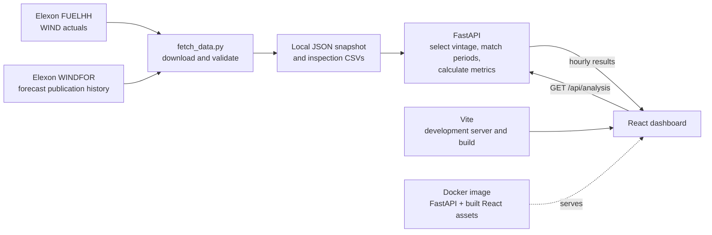

# Wind Desk

A historical day-ahead wind forecast accuracy dashboard. Wind Desk compares Elexon WINDFOR forecasts with Elexon FUELHH wind generation actuals for January 2026 decision dates.

**Stack:** React · Vite · FastAPI · Docker

> This is a historical analysis pilot. It evaluates wind forecast accuracy; it does not calculate an energy purchase recommendation.

## Deployed Vercel app - https://wind-energy-analysis.vercel.app

## What the dashboard does

- Select a delivery day or view the full period.
- Choose the prior-day decision cutoff and replay which forecast was available by then.
- Compare forecast and actual wind generation in MW.
- Review MAE, RMSE, signed bias, and WAPE.
- Export the selected hourly comparison to CSV.

## Data and method

The January decision dates are **1–31 January 2026**. Their day-ahead delivery dates run from **2 January through 1 February**. Jan 1 delivery is excluded because its decision would have been made on Dec 31.

The dashboard uses Elexon FUELHH records filtered to `fuelType=WIND` and the assignment-linked WINDFOR publication history. A saved forecast is selected only when its `publishTime` is at or before the chosen cutoff on the previous day. The assignment does not give a specific clock time, so the dashboard defaults to **11:00 Europe/London** as an explicit, adjustable assumption.

### Resolution limitation

FUELHH provides half-hourly actuals. In the January 2026 WINDFOR stream queried for this project, target `startTime`s are hourly. The pipeline averages each pair of half-hour actuals into an hourly mean, then compares that value with the hourly forecast. It does not duplicate an hourly forecast to create fake half-hour forecasts. The result is an hourly accuracy measure and does not measure within-hour forecast error. This resolution mismatch is documented because the assignment describes forecast target times as similar to the half-hour actuals.

### Dataset in this repository

| File | Contents |
| --- | --- |
| [`backend/data/january_2026.json`](backend/data/january_2026.json) | Runtime snapshot: 1,488 half-hour actual records and 17,688 forecast versions |
| [`backend/data/wind_actuals_jan_decisions.csv`](backend/data/wind_actuals_jan_decisions.csv) | FUELHH WIND actuals, one row per half-hour |
| [`backend/data/wind_forecast_history_jan_decisions.csv`](backend/data/wind_forecast_history_jan_decisions.csv) | WINDFOR target times, publication times, and forecast MW |
| [`backend/data/day_ahead_comparison_jan_decisions.csv`](backend/data/day_ahead_comparison_jan_decisions.csv) | 744 hourly comparisons at the default 11:00 cutoff |

The runtime dashboard reads the local JSON snapshot. It **does not refresh from Elexon when a page loads**. Run the downloader to refresh the fixed January 2026 data window and regenerate the snapshot and source CSVs.

## How the pipeline works



## Run with Docker

Requirements: Docker Desktop running. The Compose file names the same versioned image that is published on Docker Hub.

From the project root in PowerShell:

```powershell
docker compose pull
docker compose up -d
```

Open [http://localhost:8000](http://localhost:8000). Check the service at [http://localhost:8000/api/health](http://localhost:8000/api/health). To view logs, run `docker compose logs -f`; to stop the app, run `docker compose down`.

To build from the source files instead of pulling the published image, run `docker compose up --build -d`. This rebuilds the local image from the Dockerfile; it does not publish changes to Docker Hub.

## Run the published Docker Hub image

The image currently running in Docker Desktop is published at [Docker Hub](https://hub.docker.com/r/ashurajput08/wind-desk) as `ashurajput08/wind-desk:1.0.2`. If you are not using this project folder, on a computer with Docker Desktop installed run:

```powershell
docker pull ashurajput08/wind-desk:1.0.2
docker run --rm -p 8000:8000 ashurajput08/wind-desk:1.0.2
```

Then open [http://localhost:8000](http://localhost:8000). Press Ctrl+C in the terminal to stop the container. This runs the app on that computer; Docker Hub distributes the image but does not host a public dashboard URL.

## Run in development mode

Requirements: Python 3.12 or compatible, Node.js 22.12 or newer, and npm.

In PowerShell, start the backend:

```powershell
py -m venv .venv
.\.venv\Scripts\Activate.ps1
python -m pip install -r backend/requirements.txt
uvicorn backend.app:app --reload --port 8000
```

In a second terminal, start the frontend:

```powershell
cd frontend
npm ci
npm run dev
```

Open the Vite URL printed in the terminal. The Vite development proxy forwards `/api` requests to the FastAPI server at `127.0.0.1:8000`.

## Refresh the saved data

From the project root, with internet access:

```powershell
python backend/fetch_data.py
```

The script requests the fixed Jan 2–Feb 1, 2026 delivery window, validates expected timestamps and values, then writes `backend/data/january_2026.json` and the three CSV files listed above. It is a manual refresh command, not a scheduled job. The dashboard reads the saved snapshot after refresh/restart; it does not poll Elexon.

## Verify the project

Run the built-in checks from the project root:

```powershell
python -m unittest discover -s backend/tests -v
python -m py_compile backend/app.py backend/fetch_data.py
```

The tests check source cadence, complete hourly coverage for all 31 delivery days, cutoff eligibility, and metric calculations. To verify the production frontend and container together, run `docker compose up --build` and check `/api/health` plus a selected day in the dashboard.

## Metric definitions

| Metric | What it tells you | Unit |
| --- | --- | --- |
| MAE | Average absolute forecast miss | MW |
| RMSE | Error size with larger misses weighted more heavily | MW |
| Bias | Average `forecast - actual`; positive means wind was over-forecast on average | MW |
| WAPE | Sum of absolute errors divided by sum of actual generation | % |


## Project structure

```text
.
├── backend/
│   ├── app.py                    # FastAPI analysis API and static frontend serving
│   ├── fetch_data.py             # Elexon downloader, validation, CSV exports
│   ├── requirements.txt          # Python dependencies
│   ├── data/                     # JSON snapshot and downloaded CSVs
│   └── tests/                    # Data and analysis integration checks
├── frontend/
│   ├── index.html                # Browser entry document
│   ├── src/App.jsx               # React dashboard
│   ├── src/main.jsx              # React entry point
│   ├── src/style.css             # Responsive styles
│   ├── vite.config.js            # Local API proxy
│   ├── package.json              # Frontend dependencies and commands
│   └── package-lock.json         # Reproducible frontend dependency tree
├── Dockerfile
├── docker-compose.yml
├── .dockerignore
├── .gitignore
└── README.md
```


## Data sources

- [Elexon FUELHH stream](https://bmrs.elexon.co.uk/api-documentation/endpoint/datasets/FUELHH/stream)
- [Elexon WINDFOR stream](https://bmrs.elexon.co.uk/api-documentation/endpoint/datasets/WINDFOR/stream)

Timestamps are stored in UTC. Decision cutoffs and dashboard display use Europe/London time.

## AI disclosure

OpenAI Codex assisted with requirements extraction, implementation, and review. 
